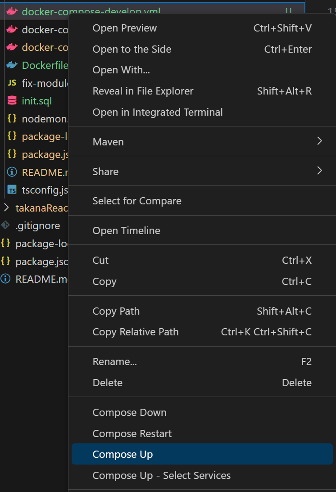

Getting started


## Database
### run docker-compose-develop

by 
vscode extensions https://marketplace.visualstudio.com/items?itemName=ms-azuretools.vscode-docker


by command line
```cmd
    docker compose -f "backend\docker-compose-develop.yml" up -d --build 
```

shutdown
by command line

``` cmd
docker compose --file 'backend\docker-compose-develop.yml' --project-name 'backend' down 
```

### check db created

- dbeaver
- pgadmin (run in docker compose)

#### pgadmin
open browser http://localhost:5050/
insert 
    username user@domain.com
    pw admin

Click on "Add new server"

connection config:
address: postgresdb
port: 5435
database: postgres
username: postgres
password: postgres

#### dbeaver
Click on "Add new server"

connection config:
address: localhost
port: 5435
database: postgres
username: postgres
password: postgres


## Server

```
cd backend

```
 Creazione del file di env di sviluppo:

 creare un file chiamato '.env' per iniettare le variabili d'ambiente.
 è sufficiente clonare '.env.development' e rinominarlo in '.env'

```
cp .env.development .env

```

Installare le dipendenze node
```
npm install

```

Avviare il backend
```
npm start

```
### Test api
Version

http://localhost:3000/api/version

Sites 

http://localhost:3000/api/sites

Trucks

http://localhost:3000/api/sites

