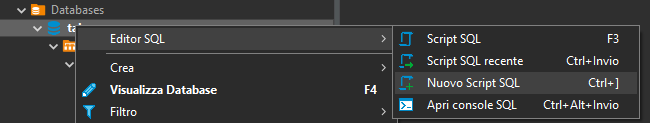
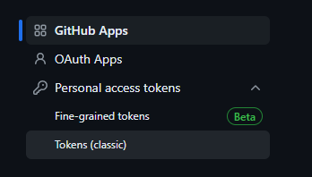
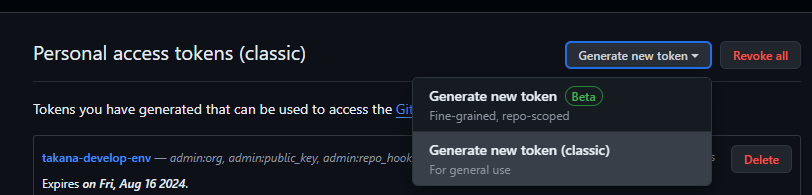
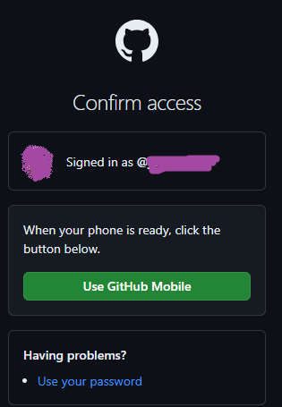
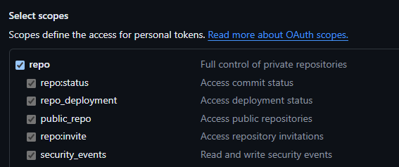

# 1. Guida alla pubblicazione di bacarotruck
In questa guida ci saranno tutti i passaggi per pubblicare l'applicazione bacarotruck.


# 2. Account
Per pubblicare le applicazioni di bacarotruck servono una serie di account:
- una email gmail
- un account ovh
- un account play.console

# 3. VPS Server
Configurazioni iniziali del server VPS 
## 3.1. Acquisto

[OVH](https://www.ovh.com/)

Acquisto del dominio nella sezione WebCloud
Dominio: bacarotruckfoodapp.ovh

Acquisto della vps

una volta acquistato arriva una email di questo tipo

```
Gentile Cliente,

ti informiamo che il tuo VPS è stato installato con il sistema operativo/distribuzione Ubuntu 24.04.

Parametri di accesso

Il nome del tuo VPS è vps-f7c48e9f.vps.ovh.net

  - indirizzo IPv4: IPV4
  - indirizzo IPv6: IPV6
  - nome utente: ubuntu
  - password, da generare utilizzando questo link:  https://www.ovh.com/manager/secret/#?id=CODICE
    Ricordiamo che il link è valido 30 giorni a partire dalla ricezione di questo messaggio. Una volta aperto, il periodo di validità sarà ridotto a 7 giorni, sempre nel limite di 30 giorni.
```

Sarà necessario impostare la password di primo accesso

## 3.2. Accedere al server
La prima volta che si accede alla VPS si deve usare questo comand
```
ssh ubuntu@IP

```

si consiglia caldamente di modificare il nome utente di default e la porta

```
ssh UTENTE@IP -p PORT
```

## 3.3. Sicurezza Server
Seguire questa guida per mettere in sicurezza il vostro server

https://help.ovhcloud.com/csm/it-vps-security-tips?id=kb_article_view&sysparm_article=KB0047709
https://help.ovhcloud.com/csm/en-au-dedicated-servers-securing-server?id=kb_article_view&sysparm_article=KB0043972

### 3.3.1. Aggiornamento del sistema
PASSAGGIO OBBLIGATORIO
Riportiamo qui i passaggi principali

```
sudo apt update
sudo apt upgrade
```

output:
```
Restarting the system to load the new kernel will not be handled automatically, so you should consider rebooting.

Restarting services...
 systemctl restart multipathd.service packagekit.service polkit.service qemu-guest-agent.service rsyslog.service udisks2.service

Service restarts being deferred:
 systemctl restart ModemManager.service
 /etc/needrestart/restart.d/dbus.service
 systemctl restart systemd-logind.service
 systemctl restart unattended-upgrades.service

No containers need to be restarted.

User sessions running outdated binaries:
 ubuntu @ session #19: apt[3212], sshd[2729]
 ubuntu @ user manager service: systemd[2736]

No VM guests are running outdated hypervisor (qemu) binaries on this host.
```
Se esce un messaggio simile riavviare la vps

Si può eseguire anche il passaggio SSH e riavviare
```
sudo reboot
```

### 3.3.2. SSH
PASSAGGIO OBBLIGATORIO
modifica porta ssh

```
sudo nano /etc/ssh/sshd_config
```

```
#Port 49152
#AddressFamily any
#ListenAddress 0.0.0.0
```
numero compreso tra 49152 e 65535

```
sudo systemctl restart sshd
```
se esce questo errore
```
Failed to restart sshd.service: Unit sshd.service not found.
```
forse dovete riavviare a causa dell'errore precedente in fase di aggiornamento.

A questo punto per rientrare dovrete fare questo comando
```
ssh username@IPv4_VPS -p NewPortNumber
```
esempio
```
ssh ubuntu@203.0.113.100 -p 49152
```

e dovrete essere impossibilitati ad accedere al sistema se usate la porta classica

```
ssh ubuntu@IP
```

### 3.3.3. Crea un account con diritti utente limitati
PASSAGGIO OBBLIGATORIO
[Guida](https://help.ovhcloud.com/csm/it-dedicated-servers-root-password?id=kb_article_view&sysparm_article=KB0043318)

Creazione di un nuovo utente
```
sudo adduser username
```

Aggiungi il nuovo account utente al sudo group:
```
sudo usermod -aG sudo username
```

Verifica
```
groups username
```

Cambio password per qualsiasi utente
```
sudo passwd ubuntu
```

Disattivazione account utente
```
sudo passwd -dl username
```

Quindi disattiviamo l'utente creato di default 'ubuntu'
```
sudo passwd -dl ubuntu
```

Attivazione account utente

```
sudo usermod username -p initialpassword
sudo passwd -u username
```

### 3.3.4. Firewall

Roles:

Abilitare solo le porte necessarie (ssh e https), 
disabilitare tutto il resto
abilitare e disabilitare le porte di servizio quando serve
PASSAGGIO OBBLIGATORIO

#### 3.3.4.1 IPTABLES 
Attenzione con iptables è complicato.

si consiglia di tenere le sole porte necessarie per l'applicativo
- 80 http: porta che verrà disabilitata alla fine del setup di tutto l'applicativo
- 443
- SSH_PORT

sudo iptables -A INPUT -p tcp --dport 80 -j ACCEPT
sudo iptables -A INPUT -p tcp --dport 443 -j ACCEPT
sudo iptables -A INPUT -p tcp --dport 56229 -j ACCEPT


la porta del db conviene aprirla solo quando è necessario consultare il db e poi disabilitarla.
Ecco il comando

Abilitare
```
sudo iptables -A INPUT -p tcp --dport PORT_DB -j ACCEPT
```
Disabilitare

```
sudo iptables -L --line-numbers
sudo iptables -D INPUT <numero_riga>
```
dove <numero_riga> è la riga con la PORT_DB

UFW
```
ufw show added
sudo ufw allow 5299/tcp
sudo ufw allow 56229/tcp 
```

#### 3.3.4.2 UFW

note: usare ufw è più semplice

Making Sure IPv6 is Enabled
```sh
sudo nano /etc/default/ufw
```

output
```sh
IPV6=yes
```

Setting Up Default Policies

```sh
## To set the default UFW incoming policy to deny, run:
sudo ufw default deny incoming

#To set the default UFW outgoing policy to allow, run:
sudo ufw default allow outgoing
```

Output:
```sh
Output
Default incoming policy changed to 'deny'
(be sure to update your rules accordingly)

Output
Default outgoing policy changed to 'allow'
(be sure to update your rules accordingly)
```

<b>è molto importante impostare la porta ssh altrimenti si perde la connessione</b>

```sh
sudo ufw allow PORT_SSH
sudo ufw allow PORT_DB
sudo ufw allow PORT_SERVER
```

Abilita UFW
<b>è molto importante impostare la porta ssh altrimenti si perde la connessione</b>

```sh
sudo ufw enable
```

<b>quando si chiude la sessione di sviluppo e lavoro si deve chiudere la porta del db e del server</b>

```sh
sudo ufw deny PORT_DB
sudo ufw deny PORT_SERVER
```

### 3.3.5. Installer Fail2ban

PASSAGGIO OBBLIGATORIO ma si può fare alla fine dell'installazione

Fail2ban è un framework di prevenzione contro le intrusioni il cui scopo è bloccare gli indirizzi IP da cui i robot o gli aggressori cercano di accedere al tuo sistema.
Questo pacchetto è indispensabile, in alcuni casi, per proteggere il tuo server dagli attacchi di tipo Brute Force o Denial of Service.

Installazione
``` sh
sudo apt install fail2ban
```

Backup conf
```
sudo cp /etc/fail2ban/jail.conf /etc/fail2ban/jail.local
```

Setup conf
```
sudo nano /etc/fail2ban/jail.local
```
sezione ssh
```
[sshd]
enabled = true
port = ssh
filter = sshd
maxretry = 3
findtime = 5m
bantime  = 30m
```


```
2024-07-20 08:51:20,538 fail2ban.jail           [1791]: INFO    Jail 'sshd' started
2024-07-20 08:51:38,753 fail2ban.filter         [1791]: INFO    [sshd] Found 93.41.61.133 - 2024-07-20 08:51:38
2024-07-20 08:53:17,415 fail2ban.filter         [1791]: INFO    [sshd] Found 93.41.61.133 - 2024-07-20 08:53:17
2024-07-20 08:53:33,631 fail2ban.filter         [1791]: INFO    [sshd] Found 93.41.61.133 - 2024-07-20 08:53:33
2024-07-20 08:53:33,785 fail2ban.actions        [1791]: NOTICE  [sshd] Ban 93.41.61.133
```


# 4. NGINX
installiamo nginx che verrà usato come load balancer e come middleware, inoltre verrà usato anche per il certificato https

```
sudo apt install nginx
```

# 5. Dominio e VPS

[Guida](https://support.us.ovhcloud.com/hc/en-us/articles/360012042099-How-to-Connect-Your-VPS-to-Your-Domain-Name)


# 6. HTTPS

[Letsencrypt](https://letsencrypt.org/)

[Certbot](https://certbot.eff.org/)

```sh
sudo apt update
sudo apt install snapd
```

```sh
sudo snap install --classic certbot
```

```sh
sudo ln -s /snap/bin/certbot /usr/bin/certbot
```

```sh
sudo certbot --nginx
```

# 7. Postgres

## 7.1. Documentation
https://www.digitalocean.com/community/tutorials/how-to-install-postgresql-on-ubuntu-20-04-quickstart

https://www.liquidweb.com/kb/install-postgresql-ubuntu/

## 7.2. Installazione

``` sh
sudo apt install postgresql postgresql-contrib
```

``` sh
sudo systemctl start postgresql.service
```


## 7.3. Configurazione
```sh
sudo -i -u postgres
```
```sh
psql
```
Informazioni di connessione
```sh
postgres=# \conninfo
```
Creazione dell'utente base
```sql
CREATE USER USERNAME_DB WITH ENCRYPTED PASSWORD 'PASSWORD';
GRANT ALL PRIVILEGES ON DATABASE DB_NAME TO USERNAME_DB; 
ALTER DATABASE DB_NAME OWNER TO USERNAME_DB;
```
```sql
CREATE USER ba7a2a WITH ENCRYPTED PASSWORD 'Porc4t4k4n4!';
CREATE DATABASE bacarotruck
GRANT ALL PRIVILEGES ON DATABASE bacarotruck TO ba7a2a; 
ALTER DATABASE bacarotruck OWNER TO ba7a2a;
```
Configurazione porta e indirizzo di connessione
```sh
sudo nano /etc/postgresql/16/main/postgresql.conf
```

```conf
#------------------------------------------------------------------------------

# - Connection Settings -

listen_addresses = '*'          # what IP address(es) to listen on;
                                        # comma-separated list of addresses;
                                        # defaults to 'localhost'; use '*' for all
                                        # (change requires restart)
port = PORT                             # (change requires restart)
max_connections = 100                   # (change requires restart)
#reserved_connections = 0               # (change requires restart)
#superuser_reserved_connections = 3     # (change requires restart)
unix_socket_directories = '/var/run/postgresql' # comma-separated list of directories
```
Configurazione PG_HBA
```sh
sudo nano /etc/postgresql/16/main/pg_hba.conf
```

```conf
local   all             postgres                                peer

# TYPE  DATABASE        USER            ADDRESS                 METHOD

# "local" is for Unix domain socket connections only
local   all             all                                     peer
# IPv4 local connections:
host    all             all             127.0.0.1/32            scram-sha-256
# IPv6 local connections:
host    all             all             ::1/128                 scram-sha-256
# Allow replication connections from localhost, by a user with the
# replication privilege.
local   replication     all                                     peer
host    replication     all             127.0.0.1/32            scram-sha-256
host    replication     all             ::1/128                 scram-sha-256
host    all             all             0.0.0.0/0               scram-sha-256
```

Riavvio
```sh
sudo systemctl restart postgresql
```

Apertura e chiusura delle tcp
```sh
sudo ufw allow 5299/tcp
sudo ufw delete  allow 5299/tcp
```

Per gravi problemi seguire questa guida

first check user postgres exists:
```sh
id postgres
```
Then:
```sh
su - postgres
```

output:
```sh
psql psql (15.1 (Debian 15.1-1.pgdg110+1)) Type "help" for help.
```
If, Password for user postgres is no known then change it: 
```sh
su - postgres
```
output: Password: su: Authentication failure

Cambio Password per utente postgresd
```sh
sudo passwd postgres
```

output
```
New password:

Retype new password:

passwd: password updated successfully
```

Finally again:

```sh
su - postgres
```

```sh
$ psql
```
psql (15.1 (Debian 15.1-1.pgdg110+1)) Type "help" for help.

## 7.4. Schema

Accedere da PGADMIN o da DBeaver al database


eseguire lo script init.sql che si trova al seguente path

```sh
PROJECT_NAME/backend/init.sql
```

copiare il contenuto.
aprire una shell sql dall'editor, come nell'esempio di dbeaver



Eseguire lo script e se tutto va bene aggiornare il database. Deve comparire lo schema bacarotruck e tutte le sue tabelle completate

# 8. Sorgenti
Scaricare i sorgenti

## 8.1. Token
Accedere a github
1) Accedere alle impostazioni del profilo 
[Settings](https://github.com/settings/profile)

2) Accedere alle impostazioni da sviluppatore
'[Developer Settings](https://github.com/settings/apps)'

3) Accedere a 'Token Classic'



4) generare un nuovo token classic



5) confermare se avete MFA



6) scopes



## 8.2. Download sorgenti

creazione della cartella source
```sh
cd
mkdir source
cd source
```

download dei sorgenti
```sh
git clone https://github.com/BacaroTech/BacarotruckMobileApp.git
```

# 9. Backend
Avviare il backend
## 9.1. NVM - NODE - NPM - PM2

installa nvm
[nvm git](https://github.com/nvm-sh/nvm)


``` sh
curl -o- https://raw.githubusercontent.com/nvm-sh/nvm/v0.39.7/install.sh | bash
```
riavviare la bash e poi eseguire i seguenti comandi per installare node e controllare che funzioni tutto controllando le versioni

```
nvm
nvm install node
nvm use node
node --version
npm --version
```

## 9.2. Compilare Sorgenti
``` sh
cd ~/source/BacarotruckMobileApp/backend
npm install
``` 

creare il file .env clonando il file .env.development. Modificare i seguenti campi

``` conf

TYPEORM_CONNECTION=NOMEDB
TYPEORM_PORT=PORTADB
TYPEORM_USERNAME=NOME_UTENTE
TYPEORM_PASSWORD=PASSWORD_DB
TYPEORM_DATABASE=NOMEDB
TYPEORM_SCHEMA=bacarotruck
``` 
compilare i sorgenti

``` sh
npm run build
``` 

## 9.3. Test
entrare nella folder dist e provare ad avviare il server

``` sh
cd ~/source/BacarotruckMobileApp/backend
cp .env ./dist
cd dist
NODE_ENV=development node main.js
``` 

aprire la porta 3000 e testare l'api di versione
``` sh
sudo ufw allow 3000/tcp

```

Test: 

http://IP_DB:3000/api/version


Disabilitare la porta
```sh
sudo ufw delete allow 3000/tcp

```

## 9.4. PM2

```sh
npm install pm2 -g
```

```sh
cd ~/source/BacarotruckMobileApp/backend/dist
NODE_ENV=development pm2 start main.js
```
Result:

```sh
bacarotruck@vps-bd598c0e:~/source/BacarotruckMobileApp/backend/dist$ NODE_ENV=development pm2 start main.js
[PM2] Starting /home/bacarotruck/source/BacarotruckMobileApp/backend/dist/main.js in fork_mode (1 instance)
[PM2] Done.
┌────┬────────────────────┬──────────┬──────┬───────────┬──────────┬──────────┐
│ id │ name               │ mode     │ ↺    │ status    │ cpu      │ memory   │
├────┼────────────────────┼──────────┼──────┼───────────┼──────────┼──────────┤
│ 0  │ main               │ fork     │ 0    │ online    │ 0%       │ 33.0mb   │
└────┴────────────────────┴──────────┴──────┴───────────┴──────────┴──────────┘

```

To show Logs
```sh
pm2 logs main
```

Update Source

```sh
cd ~/source/BacarotruckMobileApp/backend
npm run build
cp .env dist
cd dist
pm2 delete main
NODE_ENV=development pm2 start main.js
pm2 logs main
```

Result:
```sh
bacarotruck@vps-bd598c0e:~/source/BacarotruckMobileApp/backend/dist$ pm2 logs main
[TAILING] Tailing last 15 lines for [main] process (change the value with --lines option)
/home/bacarotruck/.pm2/logs/main-error.log last 15 lines:
/home/bacarotruck/.pm2/logs/main-out.log last 15 lines:
0|main     | DEBUG {
0|main     |   type: '',
0|main     |   dbHost: '127.0.0.1',
0|main     |   dbPort: '',
0|main     |   dbDatabase: '',
0|main     |   dbUsername: '',
0|main     |   dbPassword: '',
0|main     |   dbEntities: null,
0|main     |   dbSchema: '',
0|main     |   allowLogging: false
0|main     | } {}
0|main     | DEBUG require files /home/bacarotruck/source/BacarotruckMobileApp/backend/dist/api/events/Users/UserEvent.js
0|main     | 🚀 Server started at http://localhost:3000
0|main     | 🚨️ Environment: development
```


## 9.4. Configurare nginx


```sh
cd /etc/nginx/sites-available

# fare un backup
sudo cp default ~/source/default.backup.nginx
sudo cp ~/source/BacarotruckMobileApp/backend/nginx/default ./

sudo nano default
```

Abilitare le api e testare da https
``` conf
        location /api/ {
                proxy_pass http://localhost:3000/api/;
                proxy_set_header Host $host;
                proxy_set_header X-Real-IP $remote_addr;
                proxy_set_header X-Forwarded-For $proxy_add_x_forwarded_for;
                proxy_set_header X-Forwarded-Proto $scheme;
         }

       location /bacarotruckprivacy/ {
               access_log /var/log/nginx/bacarotruckprivacy.access.log;
               error_log /var/log/nginx/bacarotruckprivacy.error.log;
               alias /var/www/bacarotruckprivacy/html;
               index index.html;
               try_files $uri $uri/ =404;
               autoindex off;
       }


```

Riavviare nginx
```sh
sudo systemctl restart nginx
```

# 10 WebApp e pagine statiche

## 10.1 Privacy Policy

pubblicazione della privacy policy nella stessa vps. Dentro NGINX

Eseguire questi comandi

```sh
sudo mkdir -p /var/www/bacarotruckprivacy/html
sudo chown -R $USER:$USER /var/www/bacarotruckprivacy/html
sudo chmod -R 755 /var/www/bacarotruckprivacy

cd ~/source/BacarotruckMobileApp/webapp/privacy-policy
sudo cp index.html /var/www/bacarotruckprivacy/html/

sudo chmod -R 755 /var/www/bacarotruckprivacy/html
sudo chown -R www-data:www-data /var/www/bacarotruckprivacy/html
```
## 10.2 Pagina di cancellazione


Eseguire questi comandi

```sh
sudo mkdir -p /var/www/bacarotruckdelete/html
sudo chown -R $USER:$USER /var/www/bacarotruckdelete/html
sudo chmod -R 755 /var/www/bacarotruckdelete

cd ~/source/BacarotruckMobileApp/webapp/unregistered/deploy
sudo cp index.html /var/www/bacarotruckdelete/html/

sudo chmod -R 755 /var/www/bacarotruckdelete/html
sudo chown -R www-data:www-data /var/www/bacarotruckdelete/html
```

## 11. Utenti base database
tramite postman creare gli utenti

admin
``` sh
curl --location 'https://app.bacarotruckfoodapp.ovh/api/register' \
--header 'Content-Type: application/json' \
--data-raw '{
    "email": "bacarotruckfood.developer@gmail.com",
    "password": "Porkabacarotruck!",
    "telephone": "3483482541",
    "name": "admin"
}'
```

truck1
``` sh
curl --location 'https://app.bacarotruckfoodapp.ovh/api/register' \
--header 'Content-Type: application/json' \
--data-raw '{
    "email": "truck1@bacarotruck.it",
    "password": "bestmessicofood",
    "telephone": "3491186730",
    "name": "Truck1"
}'
```

truck2
``` sh
curl --location 'https://app.bacarotruckfoodapp.ovh/api/register' \
--header 'Content-Type: application/json' \
--data-raw '{
    "email": "truck2@bacarotruck.it",
    "password": "bestmessicofood",
    "telephone": "3513997356",
    "name": "Truck2"
}'
```

# 11. Inizializzazione calendario

Popolare il calendario con questa api, dopo aver creato l'utente di ADMIN

``` sh
curl --location 'https://app.bacarotruckfoodapp.ovh/api/calendar/create' \
--header 'Content-Type: application/json' \
--header 'Authorization: Bearer TOKEN_ADMIN' \
--data '[
    {
        "truck_code": "TRUCK_1",
        "day_code": "MON",
        "site_code": "SITE_1"
    },
    {
        "truck_code": "TRUCK_1",
        "day_code": "TUE",
        "site_code": "SITE_2"
    },
    {
        "truck_code": "TRUCK_1",
        "day_code": "WED",
        "site_code": "SITE_3"
    },
    {
        "truck_code": "TRUCK_1",
        "day_code": "THU",
        "site_code": "SITE_4"
    },
    {
        "truck_code": "TRUCK_1",
        "day_code": "FRI",
        "site_code": "SITE_5"
    },
    {
        "truck_code": "TRUCK_1",
        "day_code": "SAT",
        "site_code": "SITE_6"
    },
    {
        "truck_code": "TRUCK_1",
        "day_code": "SUN",
        "site_code": "SITE_7"
    },
    {
        "truck_code": "TRUCK_2",
        "day_code": "MON",
        "site_code": "SITE_7"
    },
    {
        "truck_code": "TRUCK_2",
        "day_code": "TUE",
        "site_code": "SITE_6"
    },
    {
        "truck_code": "TRUCK_2",
        "day_code": "WED",
        "site_code": "SITE_5"
    },
    {
        "truck_code": "TRUCK_2",
        "day_code": "THU",
        "site_code": "SITE_3"
    },
    {
        "truck_code": "TRUCK_2",
        "day_code": "FRI",
        "site_code": "SITE_4"
    },
    {
        "truck_code": "TRUCK_2",
        "day_code": "SAT",
        "site_code": "SITE_2"
    },
    {
        "truck_code": "TRUCK_2",
        "day_code": "SUN",
        "site_code": "SITE_1"
    }
]'
```

# 10. App Android

dopo aver scaricato i sorgenti compiliamo e deployamo su pm2

# 11. App IOS

# 12. Altro
